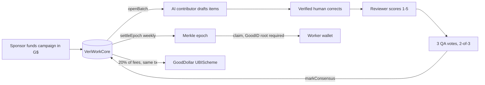

# VeriWork AI

**Help train AI as a verified human. Get paid in G$.** A GoodBuilders Season 5 project on Celo mainnet.

AI labs need human feedback they can trust: one real person per seat, not bot farms. GoodDollar already has
more than a million face-verified humans who claim UBI every day. VeriWork connects the two. Sponsors fund
labeling and RLHF campaigns in G$. An AI agent drafts every item, verified humans correct, review and
QA-approve it, and once a week everyone collects their earnings on Celo. **20% of every platform fee goes to
the GoodDollar UBI pool.**



## How G$ is integrated

| Season 5 option | In VeriWork |
|---|---|
| Identity SDK | Every paid action checks `getWhitelistedRoot` on-chain at the block of the action. The GoodID root is the one-person key for deposits, trial rewards, agent caps and reviewer conflict checks |
| Face verification + UBI claim | Verification is asked for after two free trial tasks. "Claim today's G$" is part of the daily checklist |
| UBI Pool fees | 20% of every fee (a contract constant) is transferred to UBIScheme in the same transaction that settles sponsor batches. Slashed deposits go 100% to UBI |
| Pay in G$ | Campaigns, upskill modules and AI-agent bonds are paid in G$, with EIP-2612 permit (one signature plus one transaction) |

## The Wallet Week

UBI days follow GoodDollar's 12:00 UTC boundary.

| Day | Activity |
|---|---|
| Monday | Refundable 150 G$ deposit |
| Monday to Friday | Claim UBI and finish a micro-batch |
| Friday | +400 G$ five-day bonus |
| Saturday | QA closes |
| Sunday | Collect the week's earnings and get the deposit back in one transaction |

## Security model

- **Identity boundary on-chain**: connected wallets resolve to their GoodID root, so one person cannot
  double-dip with several wallets.
- **Rolling-window circuit breaker**: every outflow passes through 24 hourly buckets, which makes a
  fixed-reset bypass impossible.
- **Guardian pause and epoch veto** by an automated sentinel. Only the admin can unpause or re-root. During
  the public demo the admin is a founder-held key; before sponsor funds are accepted it moves to a 2-of-2
  multisig.
- **No Superfluid Super App callbacks and no DEX dependency.**
- **Pull payments only**, and `balance >= accounted` invariants, because G$ is an admin-controlled token
  (pause, blocklist, fees).

Details and responsible disclosure: [SECURITY.md](SECURITY.md).

## Deployed contracts (Celo mainnet, chainId 42220)

| Contract | Address |
|---|---|
| VeriWorkCore | _pending deployment_ |
| AgentRegistry | _pending deployment_ |

Public metrics: `/dashboard` and `/api/metrics/season5`. They use the GoodBuilders metric definitions, where users
are EOAs that transact directly with the contracts above.

## Repository

| Package | Description |
|---|---|
| [`packages/contracts`](packages/contracts) | Foundry: `VeriWorkCore`, `AgentRegistry`, breaker, guardian pause; unit, fuzz, invariant and Celo-fork tests |
| [`packages/shared`](packages/shared) | Constants, verified addresses, UBI-day and week math, merkle encoding, pipeline state machine, API schemas, ABIs |
| [`packages/database`](packages/database) | Prisma 7 schema, repositories, test database helper |
| [`packages/agent-worker`](packages/agent-worker) | AI contributor, pipeline automation, weekly settlement, indexer, sentinel, Telegram notifications |
| [`packages/web-app`](packages/web-app) | Next.js app: trial funnel, work UI, Wallet Week, reviewer and QA queues, sponsor portal, public dashboard |

## Quickstart

```bash
pnpm install                      # pnpm 11 (selected via devEngines), Node 24
cp .env.example .env              # fill in what you need
pnpm db:generate
pnpm test
cd packages/contracts && forge test
RUN_FORK_TESTS=true forge test --match-path "test/fork/*" -vvv   # against Celo mainnet state
pnpm --filter @veriwork/web-app dev
pnpm --filter @veriwork/agent-worker dev
```

## Team

- **Lucas Cifuentes**, CEO
- **Christian Perez de Arce**, CTO

## License

[MIT](LICENSE)
