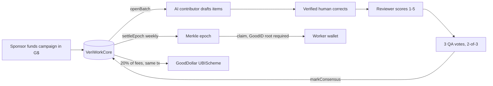

# VeriWork AI

[](https://github.com/zzzbedream/VeriworkAI/actions/workflows/ci-foundry.yml)
[](https://github.com/zzzbedream/VeriworkAI/actions/workflows/ci-webapp.yml)

**Help train AI as a verified human. Get paid in G$.** A GoodBuilders Season 5 project on Celo mainnet.

**Live:** [veriworkai.vercel.app](https://veriworkai.vercel.app) · **Contracts:** verified on Celo mainnet ([addresses](#deployed-contracts-celo-mainnet-chainid-42220))

AI labs need human feedback they can trust: one real person per seat, not bot farms. GoodDollar already has
more than a million face-verified humans who claim UBI every day. VeriWork connects the two. Sponsors fund
labeling and RLHF campaigns in G$. An AI agent drafts every item, verified humans correct, review and
QA-approve it, and once a week everyone collects their earnings on Celo. **20% of every platform fee goes to
the GoodDollar UBI pool.**



## Status (November 2026)

| Component | Status |
|---|---|
| Smart contracts (`VeriWorkCore`, `AgentRegistry`) | **Live on Celo mainnet** and verified (addresses below). 178 unit/fuzz/invariant tests, Celo-fork tests, 100% line and branch coverage. A hardened v2 that addresses an internal multi-auditor review is being finalized and will be redeployed before any sponsor funds are accepted |
| Domain logic and database (`shared`, `database`) | Done: 182 + 98 tests (payout math, merkle epochs, week/UBI-day math, atomic trial/nonce/rate limits) |
| Landing page (`web-app`) | Live at [veriworkai.vercel.app](https://veriworkai.vercel.app) |
| Full app (trial → GoodID → Wallet Week, reviewer/QA queues, sponsor portal, public dashboard) and the worker (weekly settlement, sentinel, Telegram reminders) | In progress: GoodBuilders milestone 1 (Nov 23) and milestone 2 (Dec 7) |

## How G$ is integrated

| Season 5 option | In VeriWork |
|---|---|
| Identity SDK | Every paid action checks `getWhitelistedRoot` on-chain at the block of the action. The GoodID root is the one-person key for deposits, trial rewards, agent caps and reviewer conflict checks |
| Face verification + UBI claim | Verification is asked for after two free trial tasks. "Claim today's G$" is part of the daily checklist |
| UBI Pool fees | 20% of every fee (a contract constant) is transferred to UBIScheme in the same transaction that settles sponsor batches. Slashed deposits go 100% to UBI |
| Pay in G$ | Campaigns, upskill modules and AI-agent bonds are paid in G$, with EIP-2612 permit (one signature plus one transaction) |

## The Wallet Week

UBI days follow GoodDollar's 12:00 UTC boundary.

| Day | Activity |
|---|---|
| Monday | Refundable 150 G$ deposit |
| Monday to Friday | Claim UBI and finish a micro-batch |
| Friday | +400 G$ five-day bonus |
| Saturday | QA closes |
| Sunday | Collect the week's earnings and get the deposit back in one transaction |

## How people get paid

Every piece of work is checked by other verified humans, and **everyone is paid for honest work, not for
saying "yes"**. A reviewer or QA voter earns their fee when their decision matches the final consensus,
whether the work ends up **accepted or rejected**. Rejecting bad work pays exactly the same as approving
good work, so nobody has a reason to rubber-stamp or to reject without looking.

| Role | Paid when | Amount |
|---|---|---|
| Worker | the correction is accepted by consensus | the campaign's reward per item |
| Reviewer | their verdict matches the final QA verdict | the campaign's review fee |
| QA voter | their vote is on the majority side (QA votes are blind) | the campaign's QA fee |

- Each item gets at most two attempts. Sponsors escrow the worst case up front, and any unused budget
  returns to their campaign.
- Reviewers and QA who keep disagreeing with consensus (below 70% agreement over 10+ decisions) lose
  the role.
- Sponsors choose the QA level: **Standard** (3 voters, 2-of-3) or **Pilot** (1 voter).

## Security model

- **Identity boundary on-chain**: connected wallets resolve to their GoodID root, so one person cannot
  double-dip with several wallets.
- **Rolling-window circuit breaker**: every outflow passes through 24 hourly buckets, which makes a
  fixed-reset bypass impossible.
- **Guardian pause and epoch veto** by an automated sentinel. Only the admin can unpause or re-root. During
  the public demo the admin is a founder-held key; before sponsor funds are accepted it moves to a 2-of-2
  multisig.
- **No Superfluid Super App callbacks and no DEX dependency.**
- **Pull payments only**, and `balance >= accounted` invariants, because G$ is an admin-controlled token
  (pause, blocklist, fees).

Details and responsible disclosure: [SECURITY.md](SECURITY.md).

## Deployed contracts (Celo mainnet, chainId 42220)

| Contract | Address |
|---|---|
| VeriWorkCore | [`0x54af0dfAf07E6a25B3A2aB4094b2Db302A599f9a`](https://celo.blockscout.com/address/0x54af0dfAf07E6a25B3A2aB4094b2Db302A599f9a) (verified, Sourcify exact match) |
| AgentRegistry | [`0x3bAda340d038cA32D6a807D35071CB098f1431C1`](https://celo.blockscout.com/address/0x3bAda340d038cA32D6a807D35071CB098f1431C1) (verified, Sourcify exact match) |

Public metrics (shipping with milestone 1): `/dashboard` and `/api/metrics/season5`. They use the GoodBuilders metric definitions, where users
are EOAs that transact directly with the contracts above.

## Repository

| Package | Description |
|---|---|
| [`packages/contracts`](packages/contracts) | Foundry: `VeriWorkCore`, `AgentRegistry`, breaker, guardian pause; unit, fuzz, invariant and Celo-fork tests |
| [`packages/shared`](packages/shared) | Constants, verified addresses, UBI-day and week math, merkle encoding, pipeline state machine, API schemas, ABIs |
| [`packages/database`](packages/database) | Prisma 7 schema, repositories, test database helper |
| [`packages/agent-worker`](packages/agent-worker) | AI contributor, pipeline automation, weekly settlement, indexer, sentinel, Telegram notifications |
| [`packages/web-app`](packages/web-app) | Next.js app: trial funnel, work UI, Wallet Week, reviewer and QA queues, sponsor portal, public dashboard |

## Quickstart

```bash
pnpm install                      # pnpm 11 (selected via devEngines), Node 24
cp .env.example .env              # fill in what you need
pnpm db:generate
pnpm test
cd packages/contracts && forge test
RUN_FORK_TESTS=true forge test --match-path "test/fork/*" -vvv   # against Celo mainnet state
pnpm --filter @veriwork/web-app dev       # landing today; full app in progress
pnpm --filter @veriwork/agent-worker dev  # in progress
```

## Team

- **Lucas Cifuentes**, CEO
- **Christian Perez de Arce**, CTO

## License

[MIT](LICENSE)
