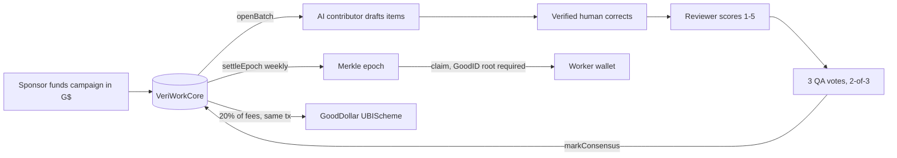

# VeriWork AI

**Help train AI as a verified human. Get paid in G$.** A GoodBuilders Season 5 project on Celo mainnet.

AI labs need human feedback they can trust: one real person per seat, not bot farms. GoodDollar already has
more than a million face-verified humans who claim UBI every day. VeriWork connects the two. Sponsors fund
labeling and RLHF campaigns in G$. An AI agent drafts every item, verified humans correct, review and
QA-approve it, and once a week everyone collects their earnings on Celo. 20% of every platform fee goes to the
GoodDollar UBI pool.



## What makes it safe

- **Identity boundary on-chain**: every paid action resolves `getWhitelistedRoot(msg.sender)` at the block of
  the action. The GoodID root is the one-person key, so connected wallets cannot double-dip.
- **Rolling-window circuit breaker**: every outflow passes 24 hourly buckets. A fixed-reset bypass (the
  Sept 4, 2026 attack pattern) is impossible.
- **Guardian pause and epoch veto** by an automated sentinel that watches the reserve price, outflows and
  posted merkle roots. Only the admin Safe can unpause or re-root.
- **No Super App callbacks, no DEX dependency, pull payments only, `balance >= accounted` invariants**,
  because G$ is admin-controlled (pause, blocklist, fees).

## Repository

| Package | Description |
|---|---|
| [`packages/contracts`](packages/contracts) | Foundry: `VeriWorkCore`, `AgentRegistry`, breaker, guardian pause. Unit, fuzz, invariant and Celo-fork tests |
| [`packages/shared`](packages/shared) | Constants, verified addresses, UBI-day/week math, merkle encoding, pipeline state machine, API schemas, ABIs |
| [`packages/database`](packages/database) | Prisma 7 schema, repositories, test database helper |
| [`packages/agent-worker`](packages/agent-worker) | AI contributor (Claude), pipeline automation, weekly settlement, indexer, sentinel, Telegram bot, cron |
| [`packages/web-app`](packages/web-app) | Next.js app: trial funnel, work UI, Wallet Week, reviewer/QA queues, B2B portal, public dashboard |


## Quickstart

```bash
pnpm install                      # pnpm 11 (auto-selected via devEngines), Node 24
cp .env.example .env              # fill in the values you need
pnpm db:generate
pnpm test                         # all packages (contracts need Foundry)
cd packages/contracts && forge test
RUN_FORK_TESTS=true forge test --match-path "test/fork/*" -vvv   # against Celo mainnet state
pnpm --filter @veriwork/web-app dev
pnpm --filter @veriwork/agent-worker dev
```


## License

MIT
